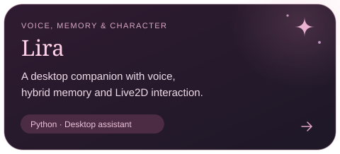
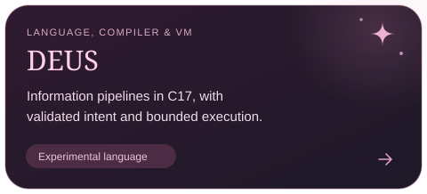
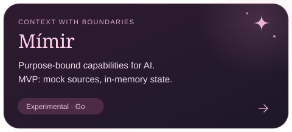
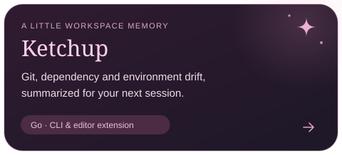
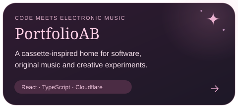

<a id="top"></a>

<div align="center">
  <a href="#about"></a>
  <a href="#building"></a>
  <a href="#skills"></a>
  <a href="#projects"></a>
  <a href="#stats"></a>
  <a href="#anime"></a>
</div>

<div align="center">
  
</div>

<p align="center"></p>

<div align="center">
  
</div>

<br>

<a id="about"></a>
<h3 align="center">✦ About Me</h3>

> *“I don't just develop software. I create characters, tools, and intelligent ecosystems.”*

I build **AI systems, developer tools, and software with personality** — from agents with voice and memory to compilers and desktop experiences. I care about how software works, how it feels, and what we can actually verify.

I also produce electronic music as **Reskyume/Rukafuu**, follow anime and visual novels with a slightly unhealthy devotion, and believe personality is not technical debt.

```ts
const lucas = {
  role: "AI & Backend Engineer",
  focus: [
    "agent systems",
    "context engineering",
    "voice and memory",
    "reliable backend architecture",
  ],
  principle: "evidence before confidence",
  currentlyPlaying: "something magical and loud at 3 AM",
};
```

<br>
<p align="center"></p>
<br>

<a id="building"></a>
<h3 align="center">♡ Building & Exploring</h3>

<div align="center">

[](https://github.com/Rukafuu/DEUS)
[](https://github.com/Rukafuu/DEUS-Vscode)
[](https://github.com/Rukafuu/TimeWarp)
[](https://github.com/Rukafuu/Ketchup)
[](https://github.com/Rukafuu/GhostCLock)
[](https://github.com/Rukafuu/ExpoMCP)

</div>

<h3 align="center">✦ Open Source Contributions</h3>

- **[Laya #269](https://github.com/NandhaKishorM/laya/pull/269) & [#706](https://github.com/NandhaKishorM/laya/pull/706)** — merged upstream. Metamorphic option-order evaluation and token-budget confounding diagnostics.
- **[Jaeger UI #4419](https://github.com/jaegertracing/jaeger-ui/pull/4419)** — merged upstream. Automatically expands GenAI attributes when they are the only section available.


<a id="skills"></a>
<h3 align="center">✧ Technologies & Practice</h3>

<div align="center">

**AI & Agent Systems**
<br>


<br>

**Backend & Systems**
<br>


<br>

**Frontend & Creative Work**
<br>


</div>

<br>
<p align="center"></p>
<br>

<a id="projects"></a>
<h3 align="center">☾ Selected Projects</h3>

<p align="center">
  <a href="https://github.com/Rukafuu/Hane"></a>
  <a href="https://github.com/Rukafuu/LiraVtuber"></a>
  <a href="https://github.com/Rukafuu/DEUS"></a>
  <a href="https://github.com/Rukafuu/Mimir"></a>
  <a href="https://github.com/Rukafuu/Ketchup"></a>
  <a href="https://github.com/Rukafuu/PortfolioAB"></a>
</p>


### More tools & past experiments

- **[TimeWarp](https://github.com/Rukafuu/TimeWarp)** — Local HTTP capture and replay tooling in Go.
- **[AAG Protocol](https://github.com/Rukafuu/AAG-Protocol)** — Draft specification and experimental benchmark for evidence-based repository context.

- **[GhostClock](https://github.com/Rukafuu/GhostCLock)** — Experimental C17/Win32 performance tooling; the current MVP measures a baseline and applies reversible process-priority changes.
- **[ExpoMCP](https://github.com/Rukafuu/ExpoMCP)** — A local MCP server for Expo/React Native project inspection, dependency checks and diagnostics.
- **[LiraOS](https://github.com/Rukafuu/LiraOS)** — An AI companion ecosystem exploring agents, visual perception, voice and conversational memory. **Paused indefinitely; maintenance and public deployment suspended.**

<br>
<p align="center"></p>
<br>

<a id="stats"></a>
<h3 align="center">✦ Statistics</h3>

<div align="center">
  
  <br><br>
  
  
</div>

<br>
<p align="center"></p>
<br>

<a id="anime"></a>
<h3 align="center">♡ Anime & Manga Status</h3>

<div align="center">
  <table>
    <tr>
      <td align="center" width="400">
        <strong>📺 Anime Stats</strong><br>
        <code>Days: 123.2</code> | <code>Mean: 7.91</code><br>
        <code>Completed: 472</code> | <code>Episodes: 7,607</code>
      </td>
      <td align="center" width="400">
        <strong>📖 Manga Stats</strong><br>
        <code>Days: 14.8</code> | <code>Mean: 8.21</code><br>
        <code>Completed: 15</code> | <code>Chapters: 1,535</code>
      </td>
    </tr>
  </table>
</div>
<br>

<div align="center">

**Favorite Anime**
<br>


<br>

**Favorite Manga**
<br>


<br>

**Favorite Characters**
<br>


</div>

<br>
<p align="center"></p>
<br>

<h3 align="center">✧ Connect With Me</h3>

<div align="center">
  <a href="https://www.linkedin.com/in/rukafuu/">
    
  </a>
  <a href="https://discord.com/users/334099538803425280">
    
  </a>
  <a href="https://portfolio.lucas-frischeisen.workers.dev/">
    
  </a>
  <a href="mailto:contato@rukafuu.dev">
    
  </a>
</div>

<br><br>

<div align="right">
  <a href="#top">
    
  </a>
</div>
