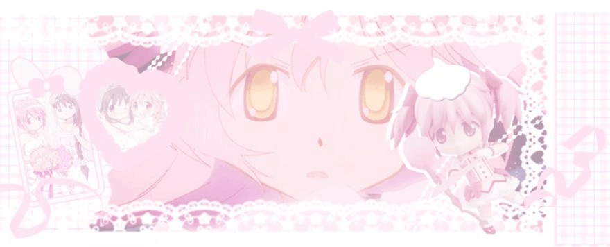

  

<h3 align="center">Lucas Frischeisen ✧</h3>

  AI systems, developer tools, and software with personality.

  <a href="https://portfolio.lucas-frischeisen.workers.dev/">Portfolio</a> &nbsp; · &nbsp;
  <a href="https://www.linkedin.com/in/rukafuu/">LinkedIn</a> &nbsp; · &nbsp;
  <a href="mailto:contato@rukafuu.dev">Email</a> &nbsp; · &nbsp;
  <a href="https://discord.com/users/334099538803425280">Discord</a>

 

I build systems that remember, tools that explain themselves, and interfaces with a little life in them.

My work moves between **agents, voice and memory**, **developer tooling**, and **backend architecture**. I care about how software works, how it feels, and what we can actually verify.

I also make electronic music as **Reskyume / Rukafuu**. Anime, visual novels, and magical girls are part of the atmosphere.

 

### A few things I'm building

**[Hane](https://github.com/Rukafuu/Hane)** &nbsp; LOCAL AGENTS  
A local-first agent orchestrator with bounded calls, scoped workspace reads, and a persistent audit trail. Your provider, your machine, a record of what happened.

**[Lira](https://github.com/Rukafuu/LiraVtuber)** &nbsp; VOICE · MEMORY · CHARACTER  
A desktop VTuber assistant bringing voice, conversational memory, local tools, and Live2D interaction into one character experience.

**[DEUS](https://github.com/Rukafuu/DEUS)** &nbsp; LANGUAGE · COMPILER · VM  
An experimental language for information pipelines, implemented in C17. The compiler validates intent; the VM enforces types and resource limits.

**[Mímir](https://github.com/Rukafuu/Mimir)** &nbsp; CONTEXT · PERMISSIONS  
An experimental Go context kernel exploring purpose-bound, short-lived capabilities for AI systems. The current MVP uses mock sources and in-memory state.

More tools, protocols & experiments

 

- **[TimeWarp](https://github.com/Rukafuu/TimeWarp)** — Local HTTP capture and replay tooling in Go.
- **[Ketchup](https://github.com/Rukafuu/Ketchup)** — A CLI and editor extension for Git, dependency, and environment drift.
- **[AAG Protocol](https://github.com/Rukafuu/AAG-Protocol)** — A draft specification and experimental benchmark for evidence-based repository context.
- **[GhostClock](https://github.com/Rukafuu/GhostCLock)** — Experimental C17/Win32 tooling for baseline measurements and reversible process-priority changes.
- **[ExpoMCP](https://github.com/Rukafuu/ExpoMCP)** — Local Expo / React Native inspection and diagnostics through MCP.
- **[PortfolioAB](https://github.com/Rukafuu/PortfolioAB)** — Code, original music, and a cassette-inspired portfolio.
- **[LiraOS](https://github.com/Rukafuu/LiraOS)** — Earlier AI companion ecosystem. Paused indefinitely; maintenance and public deployment suspended.

 

### Some work beyond my own repositories

**[Laya](https://github.com/NandhaKishorM/laya)**  
Merged contributions to metamorphic evaluation: [option-order robustness](https://github.com/NandhaKishorM/laya/pull/269) and [token-budget confounding diagnostics](https://github.com/NandhaKishorM/laya/pull/706).

**[Jaeger UI](https://github.com/jaegertracing/jaeger-ui/pull/4419)**  
Merged a GenAI trace-view improvement: expand the attributes section automatically when it is the only section available.

 

### What I work with

**Intelligence** &nbsp; Python · LLM agents · RAG · context engineering · evals  
**Systems** &nbsp; TypeScript · Node.js · Go · C17 · PostgreSQL · Docker  
**Interfaces** &nbsp; React · React Native · Expo · Tauri · Three.js · Cloudflare

 

♡

  <em>Personality is not technical debt.</em> 
  Code, electronic music, and a slightly unreasonable attachment to fictional characters.

 

Off the clock — anime, manga & favorite characters ♡

 

### Anime, manga & favorite characters

  <table>
    <tr>
      <td align="center" width="400">
        <strong>📺 Anime Stats</strong> 
        <code>Days: 123.2</code> | <code>Mean: 7.91</code> 
        <code>Completed: 472</code> | <code>Episodes: 7,607</code>
      </td>
      <td align="center" width="400">
        <strong>📖 Manga Stats</strong> 
        <code>Days: 14.8</code> | <code>Mean: 8.21</code> 
        <code>Completed: 15</code> | <code>Chapters: 1,535</code>
      </td>
    </tr>
  </table>

 

**Favorite Anime**
 

 

**Favorite Manga**
 

 

**Favorite Characters**
 

A few numbers — GitHub & profile stats

 

  
    
  
  

 

Made with curiosity, evidence, and a little magic. ✧

